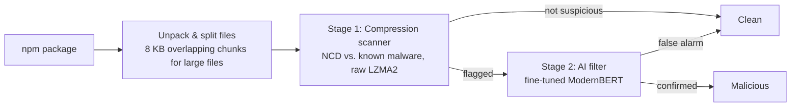

# PackGuard

**Lightweight two-stage detection of malicious npm packages using compression similarity and a small AI filter.**

> ⚠️ **Research project in progress** (ISEF, Computer Science & Software). Results, interfaces and settings may change between versions. No results are reported here until evaluation is complete.

---

## Why PackGuard?

npm is the backbone of modern web development: nearly every website, web app and JavaScript tool is built from packages downloaded through it. Attackers regularly slip malicious packages into the registry, and a single bad package can spread into thousands of projects.

Existing detectors force a trade-off:

- **Rule-based scanners** are lightweight but miss disguised (obfuscated) malware.
- **Machine-learning detectors** catch more but need powerful hardware and constant retraining.

PackGuard tests whether we can have both: accurate detection that runs on an ordinary computer.

## How it works



**Stage 1 – Compression scanner (C#).** Malicious code tends to share hidden patterns with known malware, even when disguised. PackGuard measures this with **Normalized Compression Distance (NCD)**: two files that compress much better *together* than *separately* are similar.

```
NCD(x, y) = (C(xy) − min(C(x), C(y))) / max(C(x), C(y))
```

Values near 0 mean very similar; near 1 means unrelated. Each package is scored by its most suspicious file or chunk, with a threshold tuned to catch ~99% of malware.

**Stage 2 – AI false-alarm filter (Python → ONNX).** A pretrained, code-aware model (ModernBERT) reviews **only** the packages flagged by stage 1. A hierarchical design lets it read whole packages, guided by the suspicious regions found in stage 1. The trained model is exported to ONNX, quantized to 8-bit and runs on a standard CPU.

## Repository structure (planned)

```
PackGuard/
├── src/
│   └── PackGuard.Scanner/      # C# scanner (stage 1 + ONNX inference)
│       ├── NativeLzma.cs       # P/Invoke binding to native liblzma
│       └── LzmaNcd.cs          # NCD + cached malware references
├── training/
│   └── finetune_packguard.py   # Stage 2 fine-tuning (Hugging Face)
├── data/                       # NOT committed – see "Datasets"
├── experiments/                # Configs and result logs per version
├── docs/                       # Project log, design notes
├── global.json                 # Pins the .NET SDK version
└── README.md
```

## Requirements

| Component | Version |
|---|---|
| .NET SDK | 11.0 (pinned in `global.json`) |
| liblzma (xz) | 5.4.x or a recent 5.8.x — **never 5.6.0 or 5.6.1** (CVE-2024-3094 backdoor) |
| Python | 3.10+ |
| Python packages | `transformers`, `datasets`, `torch`, `scikit-learn`, `pandas`, `optimum` |
| GPU | Only for training (e.g. free Google Colab T4). Detection runs on CPU. |

## Getting started

### 1. Install the .NET 11 SDK

Download the **SDK** (not just the runtime) from <https://dotnet.microsoft.com/download/dotnet/11.0>, then verify:

```bash
dotnet --version   # should start with 11.0
```

### 2. Install liblzma

```bash
# Linux (usually preinstalled)
sudo apt install liblzma5 liblzma-dev
# macOS
brew install xz
```

On Windows, place `liblzma.dll` from the official xz release next to the executable.

### 3. Build the scanner

```bash
dotnet build src/PackGuard.Scanner -c Release
```

Optional single native executable (Native AOT, with liblzma statically linked):

```bash
dotnet publish src/PackGuard.Scanner -c Release -r linux-x64
```

### 4. Train the AI filter

```bash
pip install -r training/requirements.txt
python training/finetune_packguard.py
```

## Scanner output format

The scanner writes one JSON file per package, which stage 2 reads:

```json
{
  "package": "example-pkg",
  "version": "1.0.2",
  "score": 0.41,
  "chunks": [
    { "file": "install.js", "start": 0, "ncd": 0.41, "text": "..." }
  ]
}
```

Lower `ncd` = more similar to known malware.

## Default configuration (v1)

| Setting | Value |
|---|---|
| Comparison unit | Per file; files > 16 KB split into 8 KB chunks with 4 KB overlap |
| Compressor | Raw LZMA2 (liblzma), preset 6 + extreme, 1 MB dictionary, `lc = 3` |
| Package score | Most suspicious file/chunk (minimum NCD) |
| Stage 1 threshold | Tuned for ~99% malware recall on validation data |
| Stage 2 model | ModernBERT-base, fine-tuned, 8-bit quantized ONNX |

## Datasets

Malware is **not** included in this repository. Sources used:

- [DataDog malicious software packages dataset](https://github.com/DataDog/malicious-software-packages-dataset)
- Backstabber's Knife Collection (Ohm et al., 2020)
- MalwareBench (access on request)
- [OpenSSF malicious-packages](https://github.com/ossf/malicious-packages) (used to confirm live-scan detections)

Benign packages are downloaded from the public npm registry. Near-duplicates are removed and data is **split by publication date** to simulate detecting unseen attacks.

## Evaluation

- **Metrics:** precision, recall, F1, false alarm rate, processing time, memory use
- **Baseline:** GuardDog, evaluated on the same test data
- **Experiments:** compressor (xz vs. zstd vs. PPMd), chunk size (4 / 8 / 16 KB), with vs. without the AI filter
- **Live test:** 30-day scan of newly published npm packages, confirmed via npm security takedowns and OpenSSF reports

## ⚠️ Safety

This project handles **real, active malware**.

- Never run `npm install` on any sample.
- Keep samples in their encrypted archives until needed; extract only inside a virtual machine.
- Malware is read strictly as text; PackGuard never executes package code.
- Suspicious live-scan findings are reported responsibly to npm's security team.

## Team

| Member | Role |
|---|---|
| Mayar | AI filter (Python): fine-tuning, evaluation, graphs |
| Fahad | Compression scanner (C#): NCD engine, liblzma binding, live scan |

## License

_To be decided._ Third-party components: liblzma (public domain / 0BSD), ModernBERT (Apache 2.0), ONNX Runtime (MIT), .NET (MIT).
