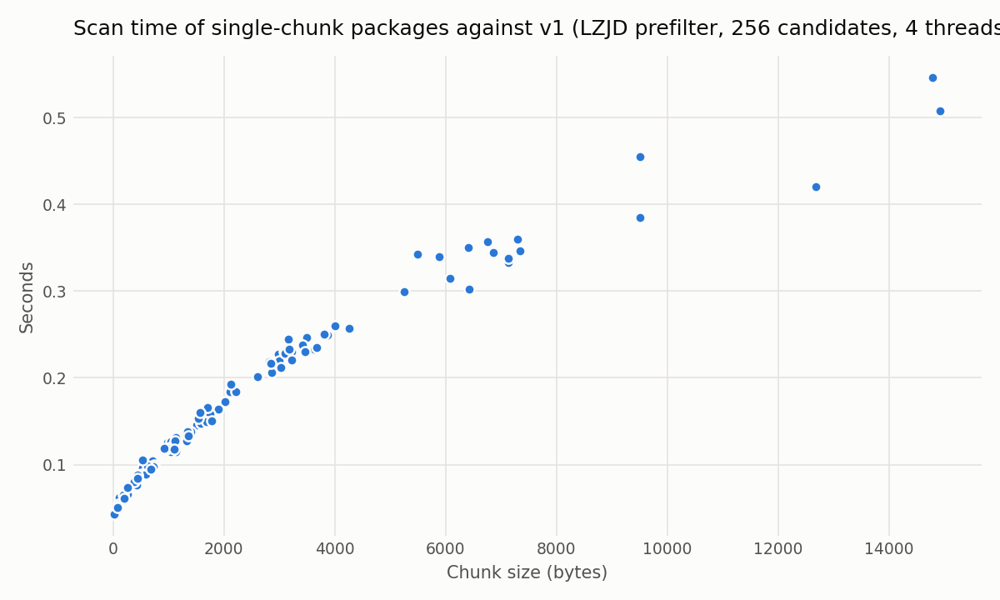
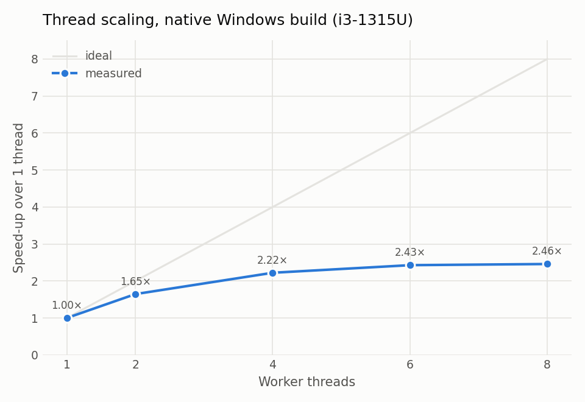
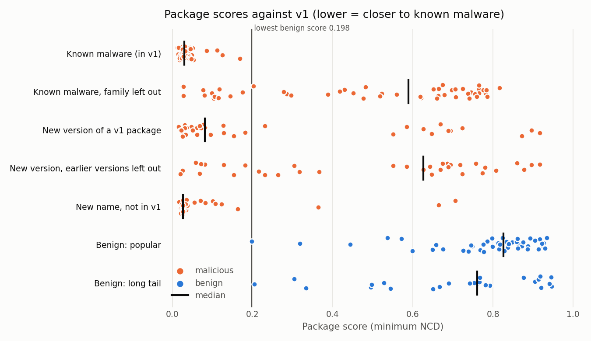
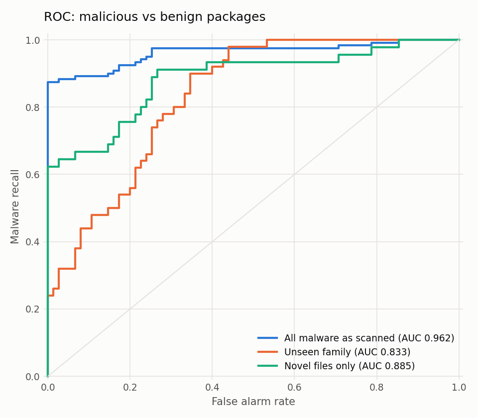
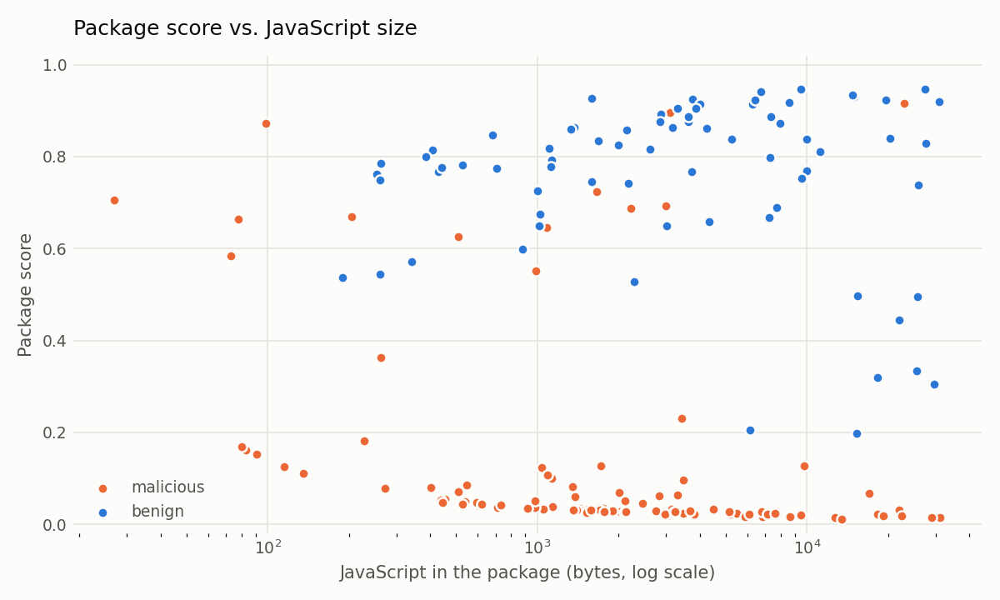

# v1 detailed test

Stage 1 of PackGuard v1 (NCD against the v1 malware set) run on 195 npm packages in five categories, with and without the LZJD prefilter. Run on 2026-10-24.

## Summary

- **Speed.** With the LZJD prefilter (default, 256 candidates) a package takes **0.23 s at the median** over all 195 packages on 4 threads, after a one-time 35–48 s load of v1. The full 195-package test ran in **2 min 1 s**. Without the prefilter (brute force) the median was 33.6 s per package and the test would have taken about 5–6 hours.
- **The prefilter costs no malware detection on the packages checked.** On the 59 packages scanned both ways, all 36 malicious packages got exactly the brute-force score, and so did every leave-family-out and leave-name-out score. Only benign packages changed, always upward (further from malware). AUC is the same, 0.976.
- **Known malware and its clones are caught.** At a threshold of 0.19, just below the lowest benign score (0.198), stage 1 flags all 50 known packages, 32 of 35 renamed clones and 23 of 35 new versions of known packages, with **0 of 75 benign packages flagged**.
- **Unseen malware mostly is not.** With its whole family removed from the references, known malware is flagged at 0.19 only 24% of the time (12/50). Stage 1 recognises families it has seen; it does not generalise to new ones. That is what NCD against a reference set does, and it is the gap stage 2 has to fill.
- **Two kinds of false alarm** come from the benign side: libraries that malware copies (`body-parser` matched the typosquat `boby_parser`, 0.319) and tiny generic files (a 2-line TypeScript stub in `isexe`, 0.198).
- **Very small files defeat NCD.** Of the 13 malicious packages under 300 bytes of JavaScript only 7 are flagged at 0.19, against 98 of the 107 larger ones; for malware, size and score correlate at Spearman −0.68.

## Setup

| | |
|---|---|
| References | v1 malware set: 39,119 files, 190,939 chunks, **69,249 distinct**, 5,904 packages in 4,778 code-shape groups |
| Scanner | `packguard -k 32` (this branch): files over 16 KiB as 8 KiB windows every 4 KiB, raw LZMA2 preset 6, 1 MiB dictionary, `lc = 3`, C(xy) = C(x) + C(y\|x), package score = lowest chunk NCD |
| Prefilter | LZJD, bottom-k = 1024, NCD on the 256 most similar reference chunks per chunk (`-p 256`, the default) |
| Machine | Intel i3-1315U (2 performance + 4 efficiency cores, 8 threads), WSL2 Ubuntu limited to 4 processors and 5 GB, liblzma 5.8.3, GCC 15.2 |
| Test set | 195 packages of at most 32 KiB of JavaScript, see [`dataset_index.md`](../../dataset_index.md#v1-detailed-test-set) |

| Category | Packages | What it measures |
|---|---|---|
| `mal_known` | 50 | v1 packages themselves. Scored as is (memorisation) and with their family left out: the best match after excluding their own code-shape group and every group holding a package of the same name, read from the 32 closest groups that `-k 32` reports per chunk |
| `mal_newver` | 35 | A version of a v1 package name that the 3-version cap dropped. Also scored with every group of the same name left out ("earlier versions left out") |
| `mal_newname` | 35 | DataDog malware whose name is not in v1 (v1 dropped them as code-shape or exact duplicates) |
| `ben_popular` | 50 | Well-known npm packages |
| `ben_longtail` | 25 | Obscure, small, old npm packages still on the registry |

No leave-out score was censored: in every case a non-excluded group was among the 32 reported.

## Speed

### Brute force vs. LZJD prefilter (59 packages scanned both ways)

| Candidates per chunk | Scan time | Speed-up | Packages with the exact brute-force score | Within 0.01 | Same closest package | AUC |
|---|---|---|---|---|---|---|
| all 69,249 (brute force) | 3,106 s | 1× | 59/59 | 59/59 | 59/59 | 0.976 |
| 64 | 16.5 s | 188× | 50/59 | 54/59 | 50/59 | 0.976 |
| **256 (default)** | **19.5 s** | **160×** | **53/59** | **56/59** | **53/59** | **0.976** |
| 1024 | 42.0 s | 74× | 56/59 | 57/59 | 56/59 | 0.976 |
| 4096 | 148.6 s | 21× | 58/59 | 58/59 | 58/59 | 0.976 |

Every package whose score changed is benign: 36/36 malicious packages are exact at every N. The largest change, +0.072, is `inflight` (0.791 → 0.863) at every N, including 4096: its best brute-force match shares little LZ structure with it, so LZJD ranks it low. When a real near-copy exists, LZJD ranks it near the top, so the prefilter loses nothing on malware and slightly lowers the false-alarm risk on benign code. Per-package numbers: [`results/prefilter/`](results/prefilter/).

### Full run (195 packages, prefilter on)

| | |
|---|---|
| Wall time | 2 min 1 s (47.5 s loading v1: reading, C(x) and LZJD digests for 69,249 chunks) |
| Scan time | 73.3 s for 395 chunks: median 0.15 s per chunk, 0.23 s per package |
| Peak memory | 1.28 GB |



Time grows almost linearly with chunk size (Spearman 0.995 over the 115 single-chunk packages).

### Threads



Measured with the native Windows build in brute-force mode on a benign corpus. Scaling flattens after 4 threads: the i3-1315U has 2 performance cores, and each LZMA call resets a 2.3 MB hash table (sized by the 1 MiB dictionary), which makes the work memory-bound. Windows on 8 threads and WSL on 4 gave the same speed.

## Detection



| Category | Median score | Interquartile range | Min–max |
|---|---|---|---|
| Known malware (in v1) | 0.030 | 0.023–0.042 | 0.012–0.169 |
| Known malware, family left out | 0.589 | 0.221–0.735 | 0.025–0.816 |
| New version of a v1 package | 0.081 | 0.041–0.605 | 0.016–0.916 |
| New version, earlier versions left out | 0.626 | 0.199–0.721 | 0.020–0.916 |
| New name, not in v1 | 0.027 | 0.027–0.063 | 0.017–0.706 |
| Benign: popular | 0.826 | 0.754–0.874 | 0.198–0.935 |
| Benign: long tail | 0.761 | 0.544–0.904 | 0.205–0.947 |

### Malicious vs. benign (75 benign packages in every row)

| Malware set | Packages | AUC (95% bootstrap CI) | Recall with no false alarm (Wilson 95% CI) | Best F1 |
|---|---|---|---|---|
| All malware as scanned | 120 | 0.962 (0.936–0.985) | 88% (80–92%) | 0.933 at 0.182 |
| Known malware (in v1) | 50 | 1.000 | 100% (93–100%) | 1.000 at 0.169 |
| New version of a v1 package | 35 | 0.886 (0.806–0.957) | 66% (49–79%) | 0.793 at 0.182 |
| New name, not in v1 | 35 | 0.985 (0.963–1.000) | 91% (78–97%) | 0.955 at 0.163 |
| Only files not in v1 (new versions and new names) | 45 | 0.885 (0.812–0.944) | 62% (48–75%) | 0.774 at 0.733 |
| New version, earlier versions left out | 35 | 0.788 (0.687–0.875) | 26% (14–42%) | 0.667 at 0.724 |
| **Unseen family** (known, family left out) | 50 | **0.833 (0.763–0.895)** | **24% (14–37%)** | 0.744 at 0.765 |

"Recall with no false alarm" uses a threshold just below the lowest benign score (0.198). F1 assumes this test's mix of malicious and benign packages.



### Recall at fixed thresholds

| Threshold | Known | Known, family left out | New version | New version, earlier versions left out | New name | Benign false alarms |
|---|---|---|---|---|---|---|
| 0.10 | 47/50 | 6/50 | 19/35 | 6/35 | 28/35 | 0/75 |
| **0.19** | **50/50** | **12/50** | **23/35** | **9/35** | **32/35** | **0/75** |
| 0.30 | 50/50 | 16/50 | 24/35 | 12/35 | 32/35 | 2/75 |
| 0.50 | 50/50 | 22/50 | 24/35 | 15/35 | 33/35 | 8/75 |

The README's target of about 99% recall cannot be reached by stage 1 alone on unseen malware: 99% recall over all malware needs a threshold of 0.896, which flags 79% of benign packages.

## What it matched

Each report now lists `matched_packages`: every v1 package that was the closest match of at least one chunk, with its code-shape group, its lowest NCD and how many chunks matched it. Across the test:

- **Known malware:** 48 of 50 best-matched a package in their own code-shape group, and all 50 a group holding their package name.
- **New versions:** only 16 of 35 best-matched a group with their own name. The other 19 resemble other campaigns more than their own earlier versions; 12 of 35 have at least one file identical to a v1 file.
- **New names:** 27 of 35 have at least one file identical (ignoring whitespace) to a v1 file. They are clones of known campaigns under new names, which is why they score like known malware.
- **Benign false alarms, explained by the match:**
  - `body-parser@2.4.0` (0.319): all 7 chunks matched `boby_parser@2.2.0`, a typosquat in v1 that ships a copy of an older `body-parser`.
  - `isexe@4.0.0` (0.198): `dist/commonjs/options.js` is the 2-line TypeScript stub `"use strict"; Object.defineProperty(exports, "__esModule", ...)`, which appears verbatim as an empty types file in `nuvyra-marketplace-sdk@1.0.1`.

## Size



NCD needs enough data to compress. A 27-byte file cannot score low even against itself (known malware of 135 bytes scored 0.112 against its own copy in v1). The highest-scoring malware are mostly tiny: `nemo-jaws` (27 bytes, 0.706), `mender-binary-delta` (78 bytes, 0.664), `fadlsjf` (98 bytes, 0.872).

## Limitations

- **Small benign set.** 75 packages: one false alarm is 1.3% of them, and the confidence intervals above are wide. A large benign set is listed as missing in `dataset_index.md`.
- **Size cap.** Every package has at most 32 KiB of JavaScript, to match the malware (median 2.9 KB) and keep brute force feasible. Larger packages have more chunks and so more chances of a false alarm; this is not measured here.
- **Benign labels** come from being on the registry, not deprecated and not in any DataDog list; they were not audited by hand.
- **Brute-force baseline** covers 59 of the 195 packages (the run was stopped after the speed problem was found). The prefilter's effect is measured on those 59 only.
- **Leave-family-out** removes the package's code-shape group and same-name groups, but other groups of the same campaign can remain, so it is an optimistic estimate for truly new malware.

## Ideas for v2 (from these results)

- Drop trivial reference chunks (tiny or pure boilerplate such as TypeScript stubs) and skip or down-weight tiny target files.
- Detect known-library copies: compare against the clean upstream library before reporting a match (the `body-parser` case), which also helps with DataDog `compromised_lib` samples.
- Stage 2 has to carry unseen families: stage 1 at 0.19 sends it almost no benign packages, but misses most new families.

## Reproduce

All malware steps run inside WSL. `V1` is the extracted v1 set, `T` an empty folder.

```bash
python3 experiments/v1/scripts/select_tests.py --v1 $V1 --out $T
python3 experiments/v1/scripts/fetch_malware.py --v1 $V1 --out $T
python3 experiments/v1/scripts/fetch_benign.py --out $T
bash experiments/v1/scripts/run_detailed.sh build/packguard $V1 $T            # -k 32, default prefilter
python3 experiments/v1/scripts/export_results.py --test $T --out experiments/v1/results
python3 experiments/v1/scripts/analyze.py --results experiments/v1/results    # needs matplotlib, numpy
```

The brute-force baseline is the same run with `-p 0`; `compare_prefilter.py` compares two report folders.

## Files

| Path | Content |
|---|---|
| `results/packages.csv` | One row per package: category, score, scan time, closest match, leave-out scores, files identical to v1 |
| `results/chunks.csv` | One row per chunk: size, NCD, closest reference, 2nd/5th/32nd closest group NCD |
| `results/metrics.json` | Every number in this page |
| `results/baseline/` | The same CSVs for the 59 packages scanned by brute force |
| `results/prefilter/` | Brute force vs. prefilter, per N and per package |
| `results/scaling.csv` | Thread-scaling measurements |
| `results/figures/` | The charts above |

The JSON reports themselves contain malware text and stay in WSL; the CSVs hold scores, sizes and file names only.
